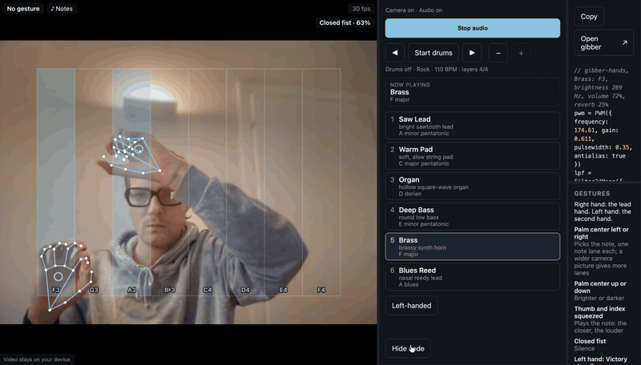

# gibber-hands

Play a synth with your hands. Webcam → MediaPipe gesture recognition → [Gibber](https://github.com/charlieroberts/gibber.audio.lib) audio, in the browser, with the live-coding snippet that reproduces what you're playing shown next to the video.



▶ [Watch the 29-second demo with sound](https://carlofanelli.github.io/gibber-hands/demo.mp4)

**Live demo: https://carlofanelli.github.io/gibber-hands/**. You need a desktop browser and a webcam. Without a webcam, sliders take over. The video never leaves your device: no analytics, no cookies.

**Status:** live. Tested on desktop Chrome.

## How to play

Open the live demo and allow the camera. Press **Start audio**, raise your hand and squeeze thumb and index together. Press <kbd>?</kbd> in the app for every control and shortcut.

### One hand

| Lead hand (your right, unless you choose Left-handed) | What it does |
|---|---|
| Palm center left or right | picks the note: one note lane each, 8 across the playing zone (the middle of the view), up to 16 as the camera picture widens on screen |
| Palm center up or down | brighter or darker (filter cutoff) |
| Thumb and index squeezed | plays the note: touching is full volume, apart is silence, so a relaxed hand is quiet |
| Closed fist | silence |

### Two hands

The second hand plays notes the same way, so two notes can sound at once. A Victory sign ✌ by the second hand switches it to shape mode and back. In shape mode it plays no note:

| Second hand in shape mode | What it does |
|---|---|
| Squeeze held | every note one octave up, until you let go |
| Thumbs-down held 👎 | every note one octave down, until you let go |
| Hand up or down | more or less reverb or echo; the middle gives the preset's own amount |

### Around the hands

- **Presets:** six sounds, each with its own scale. Click one, drag it onto "Now playing", or press <kbd>1</kbd>–<kbd>6</kbd>.
- **Drums:** **Start drums** (or <kbd>D</kbd>) plays a drum loop to play over. ◀ and ▶ step through the drum patterns, Rock, House, Hip-hop and Breakbeat, each at its own tempo. − and + set the drum layers, from the kick alone to the full pattern.
- **Live code:** the Gibber code for what you're playing, updated as you play. **Copy** copies it. **Open gibber** links to [Gibber](https://gibber.cc/), the live-coding library that makes the sound.
- **Panels:** drag the bars between the camera, the instrument and the code to resize them; the sizes are remembered. <kbd>C</kbd> hides the code, and the gesture guide below it stays.
- **Keys:** <kbd>1</kbd>–<kbd>6</kbd> preset, <kbd>Space</kbd> audio, <kbd>D</kbd> drums, <kbd>C</kbd> code, <kbd>?</kbd> help.

## How it works

```
webcam ─► hands/tracker ─► HandPair  ─► mapping/handToSynth ─► SynthParams ─► synth/engine (Gibber)
                               │                                                      │
                               └─► ui (overlay, sliders fallback, panels, live code) ◄─┘
```

`HandPair`, a `HandState` for each hand, is the single contract between vision and audio, so the slider fallback and the webcam are interchangeable. The mapping is a pure, unit-tested function. The sound runs in Gibber's audio worklet: every setting glides there instead of jumping, and the drum clock runs there too.

## Where it comes from

gibber-hands brings together three projects I wrote by hand, before I used AI coding assistants. The links below point to the last commit made before 2026, so they show that code as it was written.

| Project | When | What it was | What gibber-hands takes from it |
|---|---|---|---|
| [handMouse](https://github.com/CarloFanelli/handMouse/tree/d667b5863ca18107eab35afa51db1b4b3fa73ad4) | Mar–Oct 2025 | Python + OpenCV + MediaPipe prototype: move the mouse pointer with your index finger, click with a pinch | hand landmarks, pinch geometry, gesture gating, mirrored feedback |
| [drag-kit](https://github.com/CarloFanelli/drag-kit/tree/b1dec91c12dce37b53404d96cb7eb411d7518b9b) | May 2024 | Vanilla JS drag and drop without the HTML5 Drag and Drop API | dragging presets onto the instrument; hit-testing by geometry |
| [Resizer](https://github.com/CarloFanelli/Resizer/tree/41bb3caeb96e44f805aacd81c5baa9c37921ad70) | Jun 2024 | TypeScript side-by-side panels that you resize by dragging and that remember their sizes | the three panels: camera, instrument, live code |

## Creative front-end toolbox

The techniques I learned building those projects, and where gibber-hands uses them again.

### Hands as an input device (handMouse)

- **21 landmarks per hand, in normalized coordinates.** MediaPipe's Gesture Recognizer returns each point as x and y in 0..1 relative to the frame, plus a relative depth z. handMouse reads four of them: index tip (8), thumb tip (4), index base (5) and middle tip (12). See [`update_hand_points`](https://github.com/CarloFanelli/handMouse/blob/d667b5863ca18107eab35afa51db1b4b3fa73ad4/hand_recognition.py#L113-L137).
- **A pinch is a distance under a threshold.** The 3D distance between thumb tip and index tip below 0.06 counts as a pinch, and thumb to middle below 0.045 counts as a click. See [`checkPinch` and `click`](https://github.com/CarloFanelli/handMouse/blob/d667b5863ca18107eab35afa51db1b4b3fa73ad4/hand_recognition.py#L75-L101). Fixed thresholds only hold at one distance from the camera, because the hand gets smaller as it moves away. gibber-hands has to scale them by hand size.
- **A gesture as a mode switch.** Pointer movement and clicks are only evaluated while the recognizer says `Pointing_Up`. Any other hand shape is ignored, so the hand can rest without side effects. See [`isPointing` and the main loop](https://github.com/CarloFanelli/handMouse/blob/d667b5863ca18107eab35afa51db1b4b3fa73ad4/hand_recognition.py#L289-L295). In v1 the calls that actually move and click are commented out, so you can watch the detection without losing your mouse.
- **Mirrored feedback.** The frame is flipped for display ([`cv2.flip`](https://github.com/CarloFanelli/handMouse/blob/d667b5863ca18107eab35afa51db1b4b3fa73ad4/hand_recognition.py#L285)), so moving your hand right moves it right on screen. The x coordinates are flipped when they are read (`1 - x`). Keeping track of which coordinates are already flipped is the error-prone part, so in gibber-hands the rule is written down once, in the milestone 1 spec.
- **Show what the machine sees.** Landmarks, the line between the pinching fingers, a circle whose radius grows with the pinch distance, and the gesture name with its confidence are drawn over the video. See [`draw_circle_at_center`](https://github.com/CarloFanelli/handMouse/blob/d667b5863ca18107eab35afa51db1b4b3fa73ad4/hand_recognition.py#L105-L109). Without this feedback a gesture interface feels random.
- **A control area smaller than the frame.** handMouse draws a square on the feed ([`drawSquare`](https://github.com/CarloFanelli/handMouse/blob/d667b5863ca18107eab35afa51db1b4b3fa73ad4/hand_recognition.py#L218)) as the zone the hand should stay in. The idea is that small hand movements inside it cover the whole output range, so you don't need big arm movements. In v1 the square is only drawn, and the remapping is not implemented yet.

### Pointer interaction without browser events (drag-kit)

- **Drag with plain mouse events.** On `mousedown` the element becomes `position: absolute` and follows `mousemove` deltas in page coordinates. See [`dragedrop.js`](https://github.com/CarloFanelli/drag-kit/blob/b1dec91c12dce37b53404d96cb7eb411d7518b9b/assets/js/dragedrop/dragedrop.js#L47-L70).
- **Drop zones found by geometry, not by events.** On every move the pointer position is tested against each zone's rectangle, converted to page coordinates so scrolling doesn't break it. See [`detectDropZone` and `getCoords`](https://github.com/CarloFanelli/drag-kit/blob/b1dec91c12dce37b53404d96cb7eb411d7518b9b/assets/js/dragedrop/dragedrop.js#L80-L172). This matters here because a fingertip tracked by a camera fires no DOM events. Testing a point against rectangles is the only way a hand can "drop" something.
- **A placeholder while dragging.** A semi-transparent clone with configurable opacity is appended to the element's container and removed on release. See [`createClone`](https://github.com/CarloFanelli/drag-kit/blob/b1dec91c12dce37b53404d96cb7eb411d7518b9b/assets/js/dragedrop/elements/draggableElement.js#L19-L32).
- **Style every state with classes.** You pass the class lists for "dragging" and "over a zone", for both the element and the zones. On release over a zone a single `callback(dragElement, dropZone)` fires. See [`actionOnDrop`](https://github.com/CarloFanelli/drag-kit/blob/b1dec91c12dce37b53404d96cb7eb411d7518b9b/assets/js/dragedrop/dragedrop.js#L174-L197).

### Layout that remembers (Resizer)

- **Handles generated between panels.** A handle `div` is inserted after every panel except the last. See [`addResizer`](https://github.com/CarloFanelli/Resizer/blob/41bb3caeb96e44f805aacd81c5baa9c37921ad70/src/Resize.ts#L76-L88).
- **Resize from the start position, not step by step.** Each drag reads both neighbours' widths once on `mousedown`, then sets them to that width plus or minus the total mouse movement. Small errors therefore can't add up. See [`dragMouseDown` and `elementDrag`](https://github.com/CarloFanelli/Resizer/blob/41bb3caeb96e44f805aacd81c5baa9c37921ad70/src/Resize.ts#L105-L150).
- **Sizes saved as percentages.** On release each width is stored in `localStorage` as a percentage of the parent, and restored on load, so the layout survives a reload. See [`saveSize`](https://github.com/CarloFanelli/Resizer/blob/41bb3caeb96e44f805aacd81c5baa9c37921ad70/src/Resize.ts#L152-L174) and [`giveSize`](https://github.com/CarloFanelli/Resizer/blob/41bb3caeb96e44f805aacd81c5baa9c37921ad70/src/Resize.ts#L63-L74).
- **React to the DOM, not to calls.** A `MutationObserver` watches each panel's `class` attribute. When a panel gets the "hidden" class, the visible panels are resized again from the stored percentages, and the code that hid it doesn't need to know about the layout. See [`observeElementChanges`](https://github.com/CarloFanelli/Resizer/blob/41bb3caeb96e44f805aacd81c5baa9c37921ad70/src/Resize.ts#L37-L51).

## New in gibber-hands

What this project adds to that toolbox. Where a technique was already in it, only the change is new.

### Reading the hand

- **A pinch measured against hand size.** handMouse's pinch was a fixed distance ([above](#hands-as-an-input-device-handmouse)), so it held at only one distance from the camera. Here the thumb-to-index distance is divided by hand size, from wrist to middle knuckle, so a squeeze reads the same near the camera and far from it, whichever way the hand is turned. A hand too small or too edge-on to measure keeps its last squeeze instead of reading a wrong one. See [`src/hands/geometry.ts`](src/hands/geometry.ts).
- **The mirror in one place.** handMouse flipped x where it read it. Here one function turns landmarks into the player's mirrored view, CSS flips only the video pixels, and the overlay draws the points as they come. See [`src/hands/geometry.ts`](src/hands/geometry.ts).
- **Smoothing that follows speed.** The palm center goes through a One Euro filter (Casiez et al., 2012): heavy smoothing while the hand is still, almost none when it moves fast, so the note neither jitters nor lags. See [`src/hands/smoothing.ts`](src/hands/smoothing.ts).
- **Gestures that must hold.** handMouse acted on each frame's gesture. Here a new gesture replaces the current one only after it has been reported with at least 0.6 confidence for 100 ms, so one stray frame doesn't switch a mode. See [`src/hands/gesture.ts`](src/hands/gesture.ts).
- **Two hands that keep their sides.** A new hand takes the side its left/right reading gives and keeps it until it's gone, followed by where its palm center was last seen. Crossed hands or a flickering reading never swap them, and a hand missing for under 150 ms still counts as there. See [`src/hands/handSlots.ts`](src/hands/handSlots.ts).

### Playing

- **A playing zone that remaps.** handMouse drew its control square but didn't remap it ([above](#hands-as-an-input-device-handmouse)). Here the middle 80% of the view, across and down, covers every note and the whole brightness range; outside it, values stay at its edge. See [`src/mapping/handToSynth.ts`](src/mapping/handToSynth.ts).
- **Note lanes that hold.** The current note lane holds until the palm center is a fifth of a lane past its border, so a hand resting on a border doesn't flicker between two notes. See [`src/mapping/handToSynth.ts`](src/mapping/handToSynth.ts).
- **More lanes on a wider picture.** One note lane per 80 px of playing zone on screen, from 8 up to 16. The black bars around a letterboxed picture don't count. See [`src/ui/zoneWidth.ts`](src/ui/zoneWidth.ts).

### Sound

- **Glides, not jumps.** Gibber changes a setting in one jump, which clicks. Here pitch, brightness, volume and the effect amount glide inside the audio worklet, over tens of milliseconds, so moving the hand doesn't click. See [`src/synth/engine.ts`](src/synth/engine.ts) and [`src/synth/ramp.ts`](src/synth/ramp.ts).
- **A drum clock in the audio thread.** The drum loop's clock is sent to Gibber's audio worklet as source text and runs there, so a slow video frame never moves a hit. A new drum pattern starts on the next bar. See [`src/synth/drumClock.ts`](src/synth/drumClock.ts).
- **Code that rebuilds the sound.** A pure function writes the Gibber code for what the hands play: the same oscillator, filter and effect, one chain per sounding hand, and the drums. You can paste it into the gibber.cc playground. See [`src/synth/snippet.ts`](src/synth/snippet.ts).

### Interface

- **Resizer, now with a keyboard.** The copied Resizer gets minimal fixes, each listed in its header. With the last one, Tab reaches each bar between panels and the arrow keys move it. See [`src/vendor/resizer/Resize.ts`](src/vendor/resizer/Resize.ts).
- **Step hints.** A short prompt over the camera view, with an animated hand, shows the first step the visitor hasn't done yet, until a first sound has lasted a second. Then one more teaches the Victory sign. See [`src/ui/stepHints.ts`](src/ui/stepHints.ts).
- **Storage that may be blocked.** In private mode or with site data turned off, reading gives nothing and writing does nothing, so the page works the same and just doesn't remember. See [`src/ui/storage.ts`](src/ui/storage.ts).

## Built with an AI agent, on purpose

The three projects above were written by hand. gibber-hands is built with Claude Code, through a spec-first workflow: requirements interview, task breakdown, implementation one task at a time, review.

- [`CLAUDE.md`](CLAUDE.md) is the brief the agent works from.
- [`.ai/features/`](.ai/features/) holds the approved specs, the task files and the reviews.
- [`docs/PROCESS.md`](docs/PROCESS.md) is the log: what was asked, what the agent proposed, what was accepted or rejected, and why.

## Run locally

Requires Node 24.

```bash
git clone https://github.com/CarloFanelli/gibber-hands.git
cd gibber-hands
npm ci
npm run dev
```

`npm test` runs the tests and `npm run typecheck` runs TypeScript. Every push to `main` runs typecheck, tests and build, and deploys to GitHub Pages only if all three pass. A pull request to `main` runs the same checks.

## Stack

TypeScript 7 · Vite 8 · @mediapipe/tasks-vision 1.2 · gibber.audio.lib 2.1.4 · Vitest 5 · GitHub Actions + Pages
